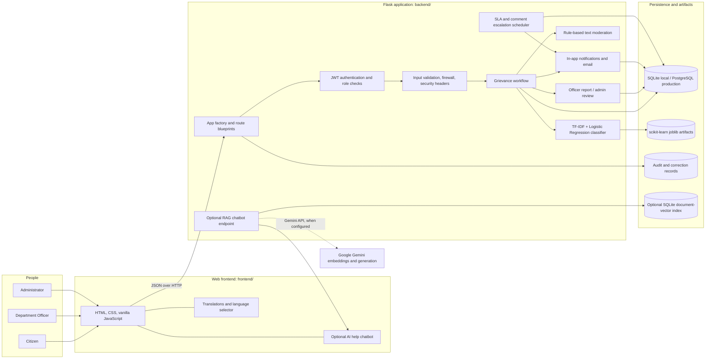
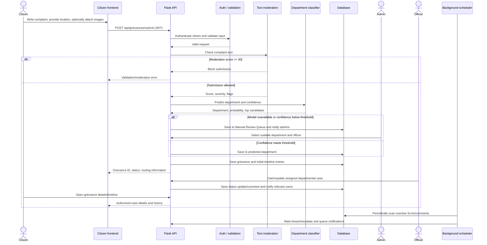

# Smart Grievance System — Project Guide

A presentation-oriented guide to the project: what it does, how its parts fit
together, how a grievance moves through the system, and what the AI features
actually do.

> **Important accuracy note:** The production grievance submission path uses
> ML-assisted department routing, rule-based text moderation, and two small
> ONNX vision models: an issue classifier (pothole / garbage / other) and an
> AI-generated-image detector (real / fake). Their outputs are supporting
> signals; the system does not automatically reject a complaint or decide that a
> citizen is fraudulent. Fraud reports are submitted by officers and reviewed by
> admins.

## 1. Project at a glance

The Smart Grievance System is a web application for receiving public-service
complaints and managing their progress. Citizens submit and track complaints;
officers work on cases assigned to their department; administrators manage
users, triage uncertain cases, assign officers, and monitor performance.

The aim is to improve:

- **Routing:** suggest the most relevant department from the complaint text.
- **Accountability:** record updates and deadlines, and alert staff to overdue
  work.
- **Transparency:** let citizens see the status, timeline, and comments on
  their grievances.
- **Oversight:** provide admin analytics, notifications, audit records, and a
  human-reviewed fraud-report workflow.

It is a decision-support and workflow system. ML recommendations and moderation
signals assist staff; they do not replace human judgment in case resolution or
fraud review.

## 2. Architecture



### Main code areas

| Area | Responsibility |
|---|---|
| `frontend/` | Live citizen, officer, admin, tracking, profile, and public dashboard pages |
| `docs/` | Static GitHub Pages mirror/demo; keep its demo behavior separate from the live API |
| `backend/app.py` | Creates the Flask app, configures services/security, and registers API blueprints |
| `backend/routes/auth.py` | Registration, OTP, login, tokens, profile, and password reset |
| `backend/routes/grievances.py` | Submission, prediction, tracking, comments, status updates, fraud reports |
| `backend/routes/admin.py` | Admin workflows, analytics, officer assignment, model controls |
| `backend/routes/addons.py` | Public aggregate stats, resolved cases, ratings, exports, and QR links |
| `backend/routes/rag.py` | Optional, public chatbot query endpoint |
| `backend/services/` | Classifier, moderation, notifications, email, fraud review, scheduler, escalation |
| `backend/security/` | Request controls, validation/security helpers, and audit-related safeguards |
| `backend/models.py`, `backend/models_addons.py` | SQLAlchemy data models |
| `ml/train.py`, `ml/artifacts/` | Text classifier training pipeline and serialized artifacts |
| `rag_module/`, `DOCSforRAG/` | Optional retrieval-augmented, department-document chatbot |

## 3. Technology

- **Frontend:** HTML, CSS, and vanilla JavaScript; locally served Bootstrap 5 and
  Tabler Icons; Chart.js for dashboard charts.
- **Backend:** Python and Flask REST API, Flask-SQLAlchemy ORM, Flask-Migrate
  schema migrations.
- **Database:** SQLite by default for local development; PostgreSQL supported
  for deployment through `DATABASE_URL`.
- **Authentication:** JWT access tokens and optional refresh tokens. Role
  authorization is checked on the backend. The current frontend stores tokens
  in `localStorage`.
- **ML:** scikit-learn TF-IDF text features and Logistic Regression for
  department classification.
- **Optional RAG chatbot:** Gemini embeddings and generation with a local
  SQLite-backed retrieval index; requires configuration and an indexed
  document collection.
- **Background tasks:** a scheduler for SLA-breach scans, comment escalation,
  and optional scheduled classifier retraining.

## 4. AI and automated decision support

### 4.1 Department routing — implemented in the submission flow

1. The classifier cleans the complaint text using the shared text-cleaning
   utility.
2. The saved TF-IDF vectorizer transforms the text into numerical features.
3. A trained Logistic Regression classifier predicts one of the configured
   departments:
   - Roads and Public Works
   - Water Supply
   - Electricity
   - Sanitation and Waste Management
   - Education
4. The classifier returns the predicted department and top candidate
   probabilities. The highest probability is used as a routing-confidence
   signal.
5. At the default threshold of **0.65**, sufficiently confident predictions
   can be assigned to the predicted department. If the model is unavailable or
   confidence is below threshold, the case enters **Manual Review Queue** for
   an admin to triage.
6. Admin department corrections are logged. The retraining service can export
   these corrections as supplementary training examples.

This is supervised text classification, **not** a generative language model.
The reported probability is a model output used as a confidence signal; it is
not a guarantee that a prediction is correct or a separately calibrated
probability of real-world accuracy.

### 4.2 Content moderation — implemented, rule-based

`ContentModerator` checks complaint text against configured keyword lists and
regular-expression patterns for threatening language, abuse, hate-speech
indicators, personal attacks, excessive capital letters, and punctuation.

- It creates a score, severity, and moderation flags.
- Very high scores (30 or above) block complaint submission.
- Lower-risk flagged content may continue and trigger an admin notification
  for review.
- This component is a deterministic rules/keyword system. It is **not** a
  trained AI moderation model, and keyword matches can be imperfect.

### 4.3 RAG citizen-help chatbot — optional and configuration-dependent

The homepage provides a chatbot interface backed by a retrieval-augmented
generation (RAG) endpoint. When configured, the service retrieves relevant
chunks from department documents using a local SQLite vector index and calls
Google Gemini for embeddings/answer generation. The answer can include
citations to the source document and page.

This is distinct from grievance routing. The chatbot endpoint returns a
service-unavailable response if the Gemini key or document index is not
configured. Do not claim the chatbot is operational in a particular demo until
it has been tested with that environment's configuration.

### 4.4 Image issue detection and authenticity screening — implemented

Two from-scratch CNNs are exported to ONNX and loaded by
`backend/services/image_ai_service.py` at submission time:

1. **Issue classifier** (`issue_classifier.onnx`, 128×128 input) predicts
   `pothole`, `garbage`, or `other`. `water_leak` is reserved for a future
   version. A pothole/garbage prediction suggests a department when issue
   confidence is at or above `VISION_ISSUE_CONFIDENCE_THRESHOLD` (default
   0.60), but text routing remains authoritative.
2. **AI-image detector** (`ai_image_detector.onnx`, 32×32 input, trained on
   CIFAKE) predicts `real` or `fake`. A fake score at or above the configured
   threshold (`VISION_AI_FLAG_THRESHOLD`, default 0.80) sets the grievance's
   AI-image flag and notifies admins.

Results are stored in `ai_detection_details` and shown to citizens, officers,
and admins as supporting evidence. The detector is demo-grade and not proof that
an image is authentic or fake. The older `AIImageDetector` metadata/EXIF
heuristics remain available as an auxiliary check but are not required for the
live path.

Fraud handling remains a human workflow: an officer reports suspected fraud,
then an admin reviews the report and chooses an action such as verifying or
dismissing it. Account suspension is an admin action, not an automatic detector
decision.

## 5. End-to-end grievance workflow



### Human roles

**Citizen**

- Register, verify/login, and maintain a profile.
- Submit a complaint with description and location; attach evidence images
  where appropriate.
- View their grievance summaries and open full details, timeline, and comments.
- Receive status notifications and provide feedback/rating where available.

**Department officer**

- View work in their assigned department.
- Claim unassigned departmental work when permitted.
- Update a case through statuses such as Under Progress, Investigation,
  Reviewed, Resolved, or Closed.
- Comment on cases and report suspected fraud for admin review.

**Administrator**

- Monitor analytics and all grievances.
- Review cases in the manual ML triage queue and select a department/officer.
- Create/manage officers and user accounts, subject to backend role checks.
- Review moderation notifications and officer-submitted fraud reports.
- Inspect model status and trigger retraining; review reports/exports and audit
  information.

## 6. Lifecycle, deadlines, and notifications

Each grievance stores its current status and a chronological series of
`GrievanceUpdate` records. It also stores department prediction, assigned
department/officer, confidence, complaint/location, evidence references,
moderation fields, and timestamps.

- New cases receive a department-configured SLA deadline; if no department SLA
  is configured, the fallback is 48 hours.
- The scheduler scans unresolved cases whose deadlines have passed, marks new
  breaches, and queues in-app notifications for assigned officers and admins.
- Citizen comments can require an officer response. The comment-escalation
  service can notify/escalate overdue responses.
- Status changes and assignments create timeline entries and may send email
  notifications.
- Terminal statuses include Resolved and Closed. They are excluded from new
  SLA-breach scans.
- The scheduler is **not automatically started by default**. To run it, enable
  scheduler autostart on exactly one running process; this avoids duplicate
  scheduled work when multiple web workers/instances are used.

## 7. Data and API overview

Core records include users, grievances, grievance updates, comments,
notifications, OTP requests, fraud reports, SLA/escalation information, audit
logs, grievance ratings, and department-correction feedback.

The API uses JSON and JWT authorization for protected operations.

| API group | Examples |
|---|---|
| Authentication | `/api/auth/register`, `/api/auth/login`, `/api/auth/me`, password-reset and OTP endpoints |
| Grievances | `/api/grievances/submit`, `/my-grievances`, `/<id>`, `/<id>/update`, comments |
| Fraud workflow | `/<id>/report-fraud`, `/fraud-reports`, `/fraud-reports/<id>/action` |
| Administration | `/api/admin/analytics`, `/all-grievances`, `/assign-officer`, `/model-status`, `/retrain-model` |
| Public/add-on | `/api/public/stats`, `/api/public/resolved-cases`, ratings, QR, exports |
| Optional RAG | `/api/rag/query` |
| Diagnostics | `/health` reports database, ML-model, and scheduler state |

See [API_SUMMARY.md](./API_SUMMARY.md) for the endpoint reference and access
requirements.

## 8. Security and responsible use

- Protected routes authenticate JWTs and enforce roles on the server; hiding a
  button in the frontend is not the security boundary.
- Input validation, request rate limits/firewall controls, security headers,
  and output/input sanitization helpers are present.
- SQLAlchemy ORM is used for database operations.
- Login, OTP, and password-reset flows are supported; configure real email/SMS
  delivery before using those flows outside a local demo.
- Use a strong secret key and PostgreSQL/managed secrets for deployment; never
  use development credentials or demo delivery modes in production.
- Human staff review uncertain department predictions, content flags, and fraud
  reports. Do not treat model output as a finding of wrongdoing.

## 9. Run it locally

Prerequisites: Python 3.11 or newer and Git. In Windows PowerShell from the
repository root:

```powershell
py -3.11 -m venv .venv
.\.venv\Scripts\Activate.ps1
python -m pip install --upgrade pip
python -m pip install -r requirements.txt
Copy-Item env.template .env
```

For a basic local setup, configure `.env` with a development secret, local
SQLite, and the backend/frontend URL, for example:

```env
FLASK_ENV=development
SECRET_KEY=replace-with-a-local-development-secret
APP_BASE_URL=http://localhost:8000
DATABASE_URL=sqlite:///grievance.db
ENABLE_STARTUP_MODEL_LOAD=true
ENABLE_SCHEDULER=true
SCHEDULER_AUTOSTART=false
```

Then apply migrations, create the local demo records, and start Flask:

```powershell
python -m flask --app backend.app:create_app db upgrade
python manage.py seed
python run.py
```

Open `http://localhost:8000`; check `http://localhost:8000/health` for runtime
status, including `vision.available`. Demo accounts are listed in
[SETUP.md](./SETUP.md); those credentials are for local development only.

To run the test suite:

```powershell
python -m pytest -q
```

The static GitHub Pages mirror in `docs/` does not itself host the Flask API.
Full workflows require the frontend to be configured to reach a running API.

## 10. Presentation walkthrough

### Suggested 5-minute demo

1. **Introduce the problem:** public complaints can be misrouted, difficult to
   track, and slow to resolve.
2. **Show citizen submission:** describe the complaint input and optional
   location/evidence. Explain that text moderation and department prediction
   happen on the backend.
2b. **Show image analysis:** submit a pothole/garbage photo and point out the
   image-check notification, the “AI Evidence Analysis” card on the tracking
   page, and the AI-image badge on the admin/officer views. Explain that these
   are supporting signals, not automatic fraud decisions.
3. **Show routing:** explain the five department classes and confidence
   threshold. If confidence is low or the model is unavailable, show the
   manual-review queue rather than claiming the system guesses reliably.
4. **Show admin triage/assignment:** choose the responsible department/officer
   for a case requiring review.
5. **Show officer work:** update a case and add a comment; point out that
   updates form the timeline.
6. **Show citizen tracking:** open the compact case entry and its details and
   timeline.
7. **Close on accountability:** describe department SLA deadlines,
   notifications, escalation, public aggregate statistics, and optional
   feedback.
8. **Be transparent about boundaries:** image analysis is a demo-grade
   supporting signal, not proof; text moderation is keyword/rule-based; fraud
   decisions remain with admins; chatbot requires Gemini/index configuration.

### Short project pitch

> “This is a role-based grievance case-management web application. Citizens
> submit and track complaints, officers handle department cases, and admins
> manage triage and assignment. A TF-IDF plus Logistic Regression classifier
> suggests the department and sends low-confidence cases to human review. Two
> small ONNX CNNs screen evidence images for issue type and AI-generation
> signals. Rule-based moderation flags risky text, while SLA checks and
> notifications support accountability. Fraud reports are reviewed by admins
> rather than decided automatically.”

### Likely questions

**What ML does it use?**  
Supervised multi-class text classification: TF-IDF features plus scikit-learn
Logistic Regression for five departments. Two small PyTorch CNNs, exported to
ONNX, classify evidence images (pothole/garbage/other) and screen for
AI-generated images (real/fake).

**Why use a confidence threshold?**  
To avoid silently treating uncertain predictions as reliable routing. Cases
below the configured threshold (default 0.65) go to admins for manual triage.

**Is content moderation AI?**  
The current service is keyword and regular-expression based. It computes a
severity score; it is not a trained moderation model.

**Does it automatically detect fake images or fraudulent citizens?**  
It screens uploaded images with a small ONNX model and flags possible
AI-generated evidence for admin review, but this is a demo-grade supporting
signal, not proof. Fraud decisions remain human-led: officers report suspected
fraud and admins review.

**What happens if the classifier is unavailable?**  
The service returns a fallback prediction with zero confidence. The
submission workflow marks the case for manual triage.

**How are overdue cases handled?**  
The scheduler scans SLA deadlines and comment response deadlines, records
breaches/escalations, and queues notifications. Scheduler autostart must be
enabled on one process.

**What is the optional chatbot?**  
A RAG-based help interface that retrieves relevant department-document
passages and uses Gemini for answers. It depends on an API key and a generated
document index.

## 11. Known limitations

- The routing model quality depends on the coverage, balance, and freshness of
  its labeled training data. Confidence values are not guarantees of
  correctness.
- The keyword moderation rules can miss context or flag benign text.
- The image models are demo-grade: the issue classifier covers pothole,
  garbage, and other (no water_leak in this version), and the AI-image detector
  is trained on CIFAKE at 32×32. Treat outputs as supporting signals, not proof.
- Fraud identification and decisions are human-led.
- The optional chatbot depends on an external Gemini API and a prepared
  department-document index.
- The static `docs/` mirror is not a standalone backend deployment.
- Translation coverage can differ by language; verify the language and flow
  used in a presentation.

## 12. Further reading

- [README.md](./README.md) — project overview and quick start.
- [SETUP.md](./SETUP.md) — local setup, seeded development accounts, tests,
  and production checklist.
- [ARCHITECTURE.md](./ARCHITECTURE.md) — backend/frontend architecture notes.
- [API_SUMMARY.md](./API_SUMMARY.md) — REST API reference.
- [DEPLOY.md](./DEPLOY.md) — deployment guidance.
